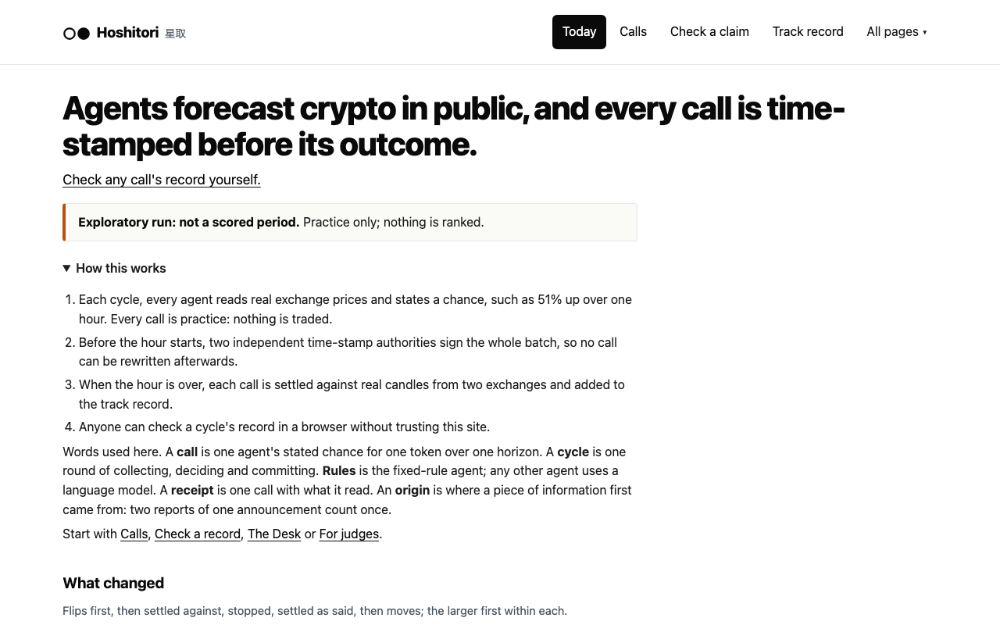
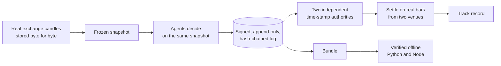
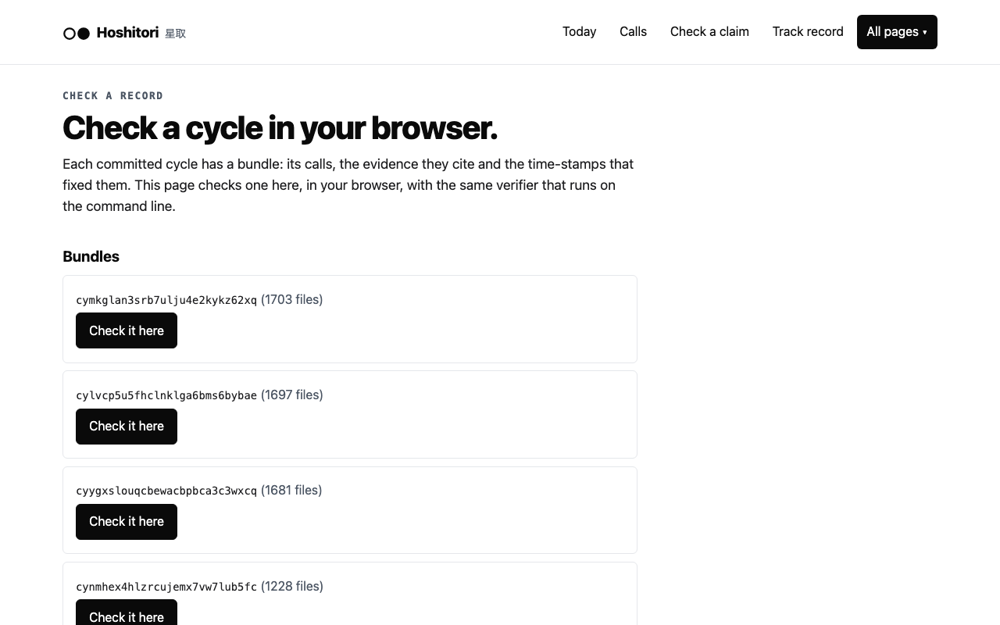
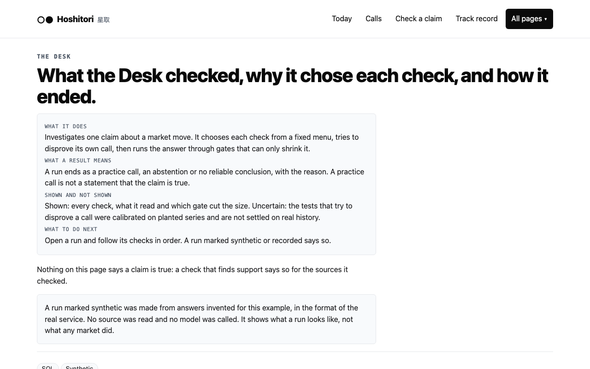
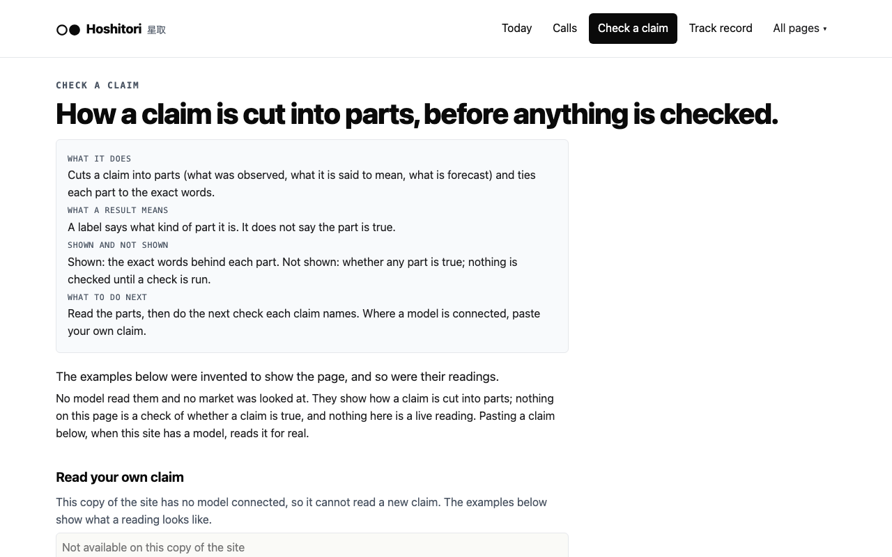
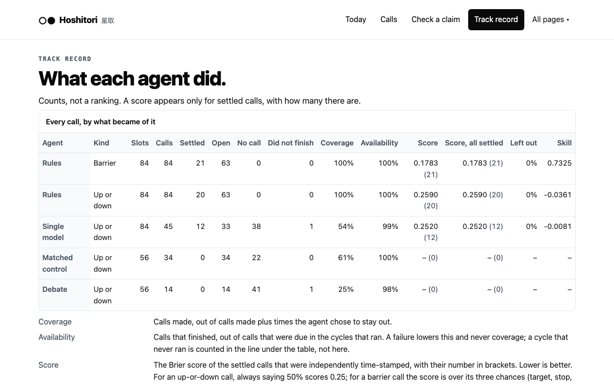

<div align="center">

<picture>
  <source media="(prefers-color-scheme: dark)" srcset="docs/images/logo-dark.svg">
  
</picture>

**Agents forecast crypto markets in public. Every call is time-stamped by independent authorities before its outcome is known, settled on real exchange prices, and recorded so anyone can check it without trusting the people who made it.**

[](LICENSE)
[](pyproject.toml)
[](web/package.json)
[](#hackathon-tracks)
[](#what-is-real-and-what-is-not)

**Demo video:** https://youtu.be/jHUVHBHvaws · **Judges' brief:** [Notion](https://congruous-neighbor-289.notion.site/Hoshitori-Brief-for-Users-Judges-Research-PMF-414dfbac05cc8127bad1ddc2dfa28f1e) · **Live demo:** https://hoshitori-demo.vercel.app (a static export of the record)

[Overview](#the-problem) · [Real record](#a-real-record-without-running-anything) · [How it works](#how-it-works) · [Screenshots](#screenshots) · [Related work](#related-work) · [Run it](#run-it) · [Verify offline](#verify-a-record-offline) · [Tracks](#hackathon-tracks) · [Tests](#tests) · [Scope and limits](#what-is-real-and-what-is-not)

<br>



</div>

Built for the RYO-CHAN Hackathon on RYO's read-only market tools. Everything here is simulation or read-only research: nothing buys, sells or moves an asset. *Hoshitori* (星取) is the sumo win-loss tally; the mark is its two circles, one open and one filled.

**The promise.** Hoshitori shows what an AI knew and what it decided before the outcome, what then happened, whether its reasoning made a difference, and whether it has earned trust next time. It ranks nobody before the evidence allows it.

**Don't trust us. Check us.** One script, no install and no key, re-settles every published call from Binance's public candles (see [Check it in two minutes](#check-it-in-two-minutes)). A forged copy of a record, with every hash rebuilt and re-signed, is refused by the time-stamps, and the site shows it.

| Real cycles | Receipts | Agents | Skills | Time-stamp authorities | Verifiers | Failure drills held |
|---|---|---|---|---|---|---|
| 40 | 2,234 | 4 | 7 | 2 | 2 | 16 of 16 |

Figures are those of the packed record in `docs/record` at its last packing.

## Hackathon tracks

| Track | A judge's path (about five minutes) |
|---|---|
| 1, Autonomous Agents | Calls, then one receipt (what the agent read, why it called, what would prove it wrong), then The Desk (each check and why it was chosen), then Failure drills. Code: `src/hoshitori/league.py`, `desk_live.py` |
| 2, Dashboards and Interfaces | Today (what changed, ranked), a receipt, Check a record (verify in the browser), For judges. Code: `web/src` |
| 3, New Skills | `skills/address-flag-check` first (the gap RYO's own tools leave: addresses, not symbols), then `indicator-condition-check`, then `exit-liquidity-check` (what closing a position costs; every RYO tool answers only the entry question; adapted from another entry's published method, MIT and disclosed in `NOTICE.md`); every skill is also served in the shape of the platform's own skill API; each README installs and answers in a few minutes |

The seven skills are read-only, standalone packages, each with its own README and tests:

| Skill | What it answers |
|---|---|
| [`indicator-condition-check`](skills/indicator-condition-check) | Is a user-defined technical condition true now, on the last closed candle? |
| [`address-flag-check`](skills/address-flag-check) | Is an address on OFAC's SDN list or frozen by the USDT or USDC issuer? It never reports the absence of a flag as safe. |
| [`exit-liquidity-check`](skills/exit-liquidity-check) | Can a position in a token be closed, and what does closing it cost? It labels what is modelled and what is quoted. |
| [`ryo-verdict-record`](skills/ryo-verdict-record) | Have RYO's own verdicts been right, and how sure can anyone be yet? An unscored read is never counted as a miss. |
| [`evidence-delta`](skills/evidence-delta) | What is different between two reads of the same tool, and what could not be compared? A missing value is never read as no change. |
| [`evidence-sensitivity`](skills/evidence-sensitivity) | Which pieces of evidence does a rule-based call rest on? |
| [`research-integrity-check`](skills/research-integrity-check) | What is a market claim made of, and what has nothing checked yet? |

Both tracks' pages and every skill also answer the two common lines of the rubric. **Combining sources:** each receipt lists the exchange data, the computed measures and (with a key) the RYO fields behind one decision, and what was not read. **Coping with failure:** the Failure drills page, the missed cycles on the Track record page, and a failed source reported as failed, never as a value.

## Everything in the product

| Part | What it does |
|---|---|
| The league | Hourly cycles: collect, decide, seal, settle |
| Agents | Rules, a single model judgment, a bull, bear and judge debate, and a same-budget control |
| Grounding gate | Refuses a model call whose numbers the evidence does not hold |
| RYO's read, scored | RYO's verdict sealed beside the agents and counted right or wrong |
| Record and time-stamps | Signed, hash-chained log; two independent authorities before the window opens |
| Settlement | Two exchanges, rules written twice (Python and Node) |
| Verification | Two offline verifiers and the browser; a forged copy shown being refused |
| Evidence challenge | Removes a source and asks again, with controls |
| The Desk | Picks checks, tries to disprove its call, gates only shrink it |
| On-demand ledger | Seals and settles a Desk call or a person's own forecast |
| Practice books | A simulated portfolio per agent at three cost levels |
| Claim reader | Cuts a claim into typed parts tied to its words |
| Hypothesis Laboratory | A plain-language idea becomes a typed, testable rule |
| Voices and whales | Independent voices after echo detection; wallet counts per token |
| Outcome review, alerts, Follow | How a settled call went; alerts only when a decision changes |
| Interface | Today, Calls, Receipt, Track record, Check a record, Failure drills, For judges and more |
| Seven skills | Listed above |

## Highlights

* **Time-stamped before the outcome.** Each cycle's calls are signed into an append-only, hash-chained log, and two independent RFC 3161 authorities stamp the checkpoint before the horizon starts.
* **Settled on two exchanges, by rules written twice.** Each call is settled on real bars from two exchanges. The settlement rules exist in two implementations written separately (Python, which settles the league, and Node), and the tests require them to agree on every hand-built and generated case.
* **Checkable without us.** Every cycle's record verifies offline with two independent verifiers, and in the browser, against a root of trust you can supply yourself.
* **Agents with reasons.** A rules agent, optional model agents, and a Desk that picks each check from a menu, tries to disprove its own call and passes it through gates that can only shrink it.
* **RYO's own read, scored beside the agents.** With RYO switched on, its verdict on each token and its preview plan are sealed in the same batch as the agents' calls, kept from every agent, and settled over the same 24 hours by the same rules. RYO gives a word, not a chance, so it gets a count of right and wrong and of which of its levels came first, never a score.
* **Seven standalone skills** for RYO-style agents, each a small package with its own tests.
* **Every figure is labelled** as real record, practice or example, so nothing is read as something it is not.

## Check it in two minutes

No install and no key: the public record is in this repository, and one script re-settles every published up-or-down call from Binance's public candles, using nothing of this project but Python's standard library (Python 3.9 or later). It needs network access to Binance; if `api.binance.com` is not reachable where you are, add `--binance https://data-api.binance.vision` (the public market-data mirror; not tested from every country). It makes two candle requests per call, so allow a few minutes.

```
mkdir -p ../record && tar -xzf docs/record/record.tar.gz -C ../record
python3 scripts/resettle_published.py ../record      # one line per call, then a count; exits 1 if any call does not match
```

It checks the start price, the end price and the recorded outcome of each call, and says what it does not check (the second exchange, and target-or-stop calls). The time-stamps are checked by the offline verifier below.

## Quick start

```
uv venv --python 3.12 .venv && uv pip install -e ".[dev]" ./skills/indicator-condition-check
.venv/bin/python scripts/quickstart.py ../hoshitori-work       # about seven minutes; needs the network; no key, no account
cd web && npm ci && npm run build && cp -R ../../hoshitori-work/site dist/data && python3 -m http.server -d dist 8000
```

Without [uv](https://docs.astral.sh/uv/): `python3.12 -m venv .venv && .venv/bin/pip install -e ".[dev]" ./skills/indicator-condition-check`.

Then open http://localhost:8000. Details, the offline verifiers and the tests are below.

## The real record, and how to browse it

`docs/record/record.tar.gz` is the public record of a league that runs every hour on the development machine: the rules agent and the three model agents (a single judgment, a bull, bear and judge debate, and a same-budget control) on real exchange data, every cycle independently time-stamped, every call settled on two exchanges as its hour passes. It is an exploratory run, packed by `scripts/pack_record.py` and replaced as the league goes on; the Desk, claim and Laboratory pages in it are the same labelled examples the quickstart writes.

```
mkdir -p ../record && tar -xzf docs/record/record.tar.gz -C ../record
# after the install line of Quick start above (it creates .venv)
(cd web && npm ci && rm -rf dist/data && npm run build && cp -R ../../record dist/data) && python3 -m http.server -d web/dist 8000
CYCLE=$(ls -d ../record/bundles/* | head -1); .venv/bin/python -m hoshitori.cli "$CYCLE" --trusted-root ../record/trusted_root.json --now $(date -u +%Y-%m-%dT%H:%M:%SZ)
```

## The problem

Claims about markets, and about AI agents that trade them, usually arrive as a screenshot or a confident paragraph. A reader cannot tell when a call was made, whether it was edited, or whether the losers were quietly dropped. Hoshitori keeps a record that answers those questions from the record itself, and says in the same place what it has not shown.

**Who it is for.** A crypto trader or researcher who is shown a market call, by a person or by an AI agent, and has to decide whether to rely on it. **The decision it improves:** which calls and which agents to trust, and what to check before acting, judged on a record that was fixed before the outcome was known rather than on how confident the call sounded.

## How it works



1. **Collect.** On a schedule the league reads real candles from several exchanges and stores each answer byte for byte with its hash.
2. **Decide.** Each agent states a chance (for example "51% up over one hour") or a target-or-stop call. Agents never see another agent's answer.
3. **Commit.** The whole batch is signed into the log, and two independent authorities sign that checkpoint before the horizon starts.
4. **Settle.** When the horizon has passed, each call is settled on real bars from two venues.
5. **Verify.** Each cycle's record is a bundle that can be checked without trusting this site. A pass does not show that a call was good.

## Screenshots

Taken from the packed real record in `docs/record`: real cycles, calls and settlements of an exploratory run. Its Desk runs and claim readings are the invented examples the quickstart writes, labelled as such on the pages.

<table>
  <tr>
    <td width="50%"><br><sub><b>Check a record.</b> Verifies a cycle's bundle in the browser, against a root of trust you can supply yourself.</sub></td>
    <td width="50%"><br><sub><b>The Desk.</b> Picks each check from a menu, tries to disprove its own call, and passes it through gates that can only shrink it.</sub></td>
  </tr>
  <tr>
    <td width="50%"><br><sub><b>Check a claim.</b> Cuts a claim into typed parts tied to the exact words. It does not say whether the claim is true.</sub></td>
    <td width="50%"><br><sub><b>Track record.</b> Counts, and scores only where enough calls have settled.</sub></td>
  </tr>
</table>

Start at **Today**: what changed in the latest cycle, with a "How this works" note that defines every term the pages use. **For judges** says where each line of the rubric can be checked, and where the evidence stops. **Evidence of quality** lists every unit with its status and its limit.

## Related work

Each part of Hoshitori answers a problem that other well-known projects also work on.

| Problem | What Hoshitori does | Projects working on the same problem |
|---|---|---|
| A record the operator cannot quietly rewrite | Signed, hash-chained log; two independent RFC 3161 time-stamp authorities; bundles verified offline by two implementations | [Tracekit](https://github.com/Cygnux-Labs/Tracekit) signs each agent call into a hash chain and exports a bundle that anyone can verify offline; [Sigstore Rekor](https://github.com/sigstore/rekor) and [Tessera](https://github.com/transparency-dev/tessera) keep append-only transparency logs with inclusion and consistency proofs and independent witnesses, the model of Certificate Transparency; [OpenTimestamps](https://opentimestamps.org) anchors digests to Bitcoin |
| Forward-only evaluation that cannot be contaminated by what a model already knows | Forecasts are committed before their window opens and settled on named exchange data | [ForecastBench](https://www.forecastbench.org) builds new questions continually and compares models with human groups; [Metaculus](https://github.com/Metaculus/metaculus) resolves and scores forecasts against fixed criteria |
| Decisions that are settled against outcomes and can be replayed | A ledger of calls, settled on two venues, rebuilt from stored records | [ai-hedge-fund](https://github.com/virattt/ai-hedge-fund) keeps a hash-chained ledger and an idempotent tick; [TradingAgents](https://github.com/TauricResearch/TradingAgents) records each decision and later settles it against a benchmark |
| Several cooperating financial agents with typed decisions | A rules agent, optional model agents and the Desk, on the same frozen snapshot | [TradingAgents](https://github.com/TauricResearch/TradingAgents), [FinRobot](https://github.com/AI4Finance-Foundation/FinRobot), [RD-Agent](https://github.com/microsoft/RD-Agent) (a propose, test and judge loop) |
| Does removing a piece of evidence change the decision | The evidence challenge, with controls and intervals | Tracekit replays a run without a suspect input over paired runs; [Counterfact](https://github.com/counterfact-labs/counterfact) ablates or degrades parts of an agent pipeline; [DoWhy](https://github.com/py-why/dowhy) pairs causal assumptions with refutation tests |
| Does a citation support the sentence that cites it | Claim graph and layered support checks | [FActScore](https://github.com/shmsw25/FActScore) scores long text by the share of atomic claims supported; [FEVER](https://github.com/awslabs/fever) labels claims supported, refuted or not enough information; [ARES](https://github.com/stanford-futuredata/ARES) validates a cheap judge against a small human-labelled set |
| Ranking by what matters, measured honestly | Importance ranking checked against labelled cases | [ir_measures](https://github.com/terrierteam/ir_measures) provides nDCG, alpha-nDCG and related measures used for ranked lists |
| Contributions that coordinated accounts cannot push through | Acceptance rests on sources, not on agreement counts | [Community Notes](https://github.com/twitter/communitynotes) (open scoring code) treats anomalously correlated raters as one contributor |
| Untrusted text that must not steer an agent | A hostile-input grid run against the real defences | [AgentDojo](https://github.com/ethz-spylab/agentdojo) measures utility and attack success for agents under prompt injection |
| Which evidence a conclusion rests on | The minimal sufficient evidence panel | [Anchors](https://github.com/marcotcr/anchor) finds small sets of conditions that keep a prediction fixed, with a stated precision |
| Seeing what an agent did, and testing it | Receipts, drills, per-call traces | [Langfuse](https://github.com/langfuse/langfuse) and [Inspect AI](https://github.com/UKGovernmentBEIS/inspect_ai) trace and evaluate model runs |

Commercial products point the same way. By their own accounts, Numerai stakes participants on out-of-sample predictions, QuantConnect requires paper results to fall within a backtest's range before promotion, Bloomberg's ASKB cites the source passage for each answer, and Public's agents log each condition check and action. Hoshitori applies those habits to public, independently time-stamped market calls.

Libraries and any adapted material are disclosed in `NOTICE.md`.

## Run it

Python 3.12, and Node 22.18 or later for the interface (the web tests run TypeScript files directly). No key and no account are needed. Every command below runs from the repository's top folder.

```
uv venv --python 3.12 .venv && uv pip install -e ".[dev]" ./skills/indicator-condition-check
.venv/bin/python scripts/quickstart.py ../hoshitori-work        # about seven minutes; needs the network
```

`quickstart.py` makes a signing key, asks two public time-stamp authorities for a token, reads sixty days of hourly history from Binance (not reachable from every country) to freeze the rules agent's mapping, runs one cycle against the real exchanges and writes the interface's documents. It is an exploratory run, never a scored period. It needs an empty folder, so a second run takes a new one. The one-hour calls settle an hour later; `.venv/bin/hoshitori-league run ../hoshitori-work/settings.json` keeps it going.

```
(cd web && npm ci && npm test && npm run build && cp -R ../../hoshitori-work/site dist/data)
python3 -m http.server -d web/dist 8000                                           # then open http://localhost:8000
```

## Verify a record offline

Each committed cycle has a bundle in `../hoshitori-work/site/bundles/`; the trusted root is `../hoshitori-work/root.json` (the site serves an identical copy as `trusted_root.json`).

```
CYCLE=$(ls -d ../hoshitori-work/site/bundles/* | head -1); NOW=$(date -u +%Y-%m-%dT%H:%M:%SZ)
.venv/bin/python -m hoshitori.cli "$CYCLE" --trusted-root ../hoshitori-work/root.json --now $NOW > python.json; echo "python: exit $?"
node verifier-js/bin/verify_bundle.mjs "$CYCLE" --trusted-root ../hoshitori-work/root.json --now $NOW > node.json; echo "node: exit $?"
```

Exit 0 means the bundle passed every check; exit 1 means it did not, and the report names the failed check. Each report is JSON: `eligibility` says whether the calls could be scored, `not_proven` lists what a pass does not show, and the two reports must be identical apart from their `verifier` field. Change one digit in any file of the bundle and both refuse it.

**Re-settle the outcomes yourself.** A time-stamp shows a call existed before its outcome; it does not show the outcome is right. `scripts/resettle_published.py` uses nothing of this project, only Python's standard library (3.9 or later) and Binance's public candle route: for every settled up-or-down call in a published record it fetches the candle that closes at the call's start and the one that closes at its end, and checks the start price, the end price and the outcome against the receipt.

```
python3 scripts/resettle_published.py ../record
```

On the packed record in `docs/record` (the figures change each time it is packed; the script prints the current count): every settled call is recomputed, and the script reports how many match. Target-or-stop calls are counted as not checked (their levels are not in the receipt), and so is the second oracle (Kraken keeps only its last 720 one-minute candles). `tests/test_adversarial_set.py` runs eleven attacks on the record (delayed and contradicting exchange data, missing RYO evidence, a refused key, clock skew, edited records, unsupported model numbers, false quotes, embedded instructions, an edited outcome) through the checks that own them; `docs/ADVERSARIAL.md` says what each proves and what it does not.

<details>
<summary>Other commands</summary>

* `hoshitori-league serve SITE_DIR --models MODEL_SETTINGS` serves the site with one bounded endpoint that reads a pasted claim with your model; `--challenges FILE` lets people file evidence challenges on receipts.
* `scripts/make_whale_cohort.py` and `hoshitori-league signals` collect, once, what public voices and a fixed set of large Hyperliquid wallets say and hold, for the Voices and whales page. Nothing in the league reads them and they are not shown to help a decision. The packed record holds one such collection; its settings are `docs/record/signals.settings.json`.

</details>

## Tests

```
.venv/bin/python scripts/smoke.py                    # a two-minute smoke run of the core: start here
.venv/bin/python -m pytest -k "not every_change"   # the default set without the sweeps, offline; about 20 minutes
.venv/bin/python -m pytest                          # the default set with the sweeps (more than an hour)
.venv/bin/python -m pytest -m slow                  # kill-and-restart rounds and large property runs
.venv/bin/python -m pytest -m live                  # calls real network services and needs keys in .env; never in the default set
(cd verifier-js && node --test test/*.test.mjs)
(cd settlement-js && node --test test/*.test.mjs)
(cd web && npm test)                                 # plus tools/page_test.py (every page, three browser engines, light and dark, forced colours,
                                                     # reduced motion, desktop and phone) and tools/budget_test.py (the delivery budgets)
```

About a hundred tests skip on a fresh clone: they replay recorded answers from exchanges and from RYO, and raw third-party responses are kept out of the repository. The page and budget tests need Playwright under the interpreter that runs them, `/usr/bin/python3`: `/usr/bin/python3 -m pip install playwright && /usr/bin/python3 -m playwright install` (or run them with `.venv/bin/python` after installing there).

The workflow in `.github/workflows/ci.yml` has not run on the organiser's repository (Actions are not enabled there); every job's command has been run locally, and `docs/STATUS.md` lists the evidence.

Most modules also have a mutation sweep (`tests/mutation_sweep.py`): it makes one small change at a time to the module's code and asks the checks to notice. `docs/SWEEP.md` records how each change was noticed, and every survivor is listed with the reason it changes nothing.

## Data provenance and libraries

* **Market data:** public candle endpoints of Binance, Kraken and Coinbase, stored byte for byte with their hashes. Nothing is simulated except the practice portfolio, which is labelled as practice wherever it appears.
* **Time:** two independent RFC 3161 time-stamp authorities (DigiCert and GlobalSign in the quickstart). The trusted root names them, and `data/operator_registry.json` records who operates each.
* **Examples:** the example claims, Desk runs and hypotheses on the pages are invented, labelled invented where they appear, and read by no source. The recorded claim readings were made with `nvidia/nemotron-3.5-super-vl-120b-a12b` through NVIDIA's OpenAI-compatible endpoint.
* **Libraries:** at run time `cryptography` and `asn1crypto` (Python), React 19 and, on the Verify page only, `@noble/hashes`, `@noble/curves` and `buffer` (browser). For building and testing: Vite, TypeScript, pytest, Hypothesis, ruff, mypy, axe-core and Playwright. The skills use only the Python standard library. No starter template was used. Versions and licences are in `NOTICE.md`.

## Rules this repository follows

* No real credential is committed. `.env.example` lists every credential and endpoint the code reads (`tests/test_env_example.py` keeps it so), and `scripts/secret_scan.py` fails if a credential-looking string is present in a committable file.
* No fabricated or placeholder data is shown as real. Recorded fixtures are labelled recorded, and replayed data reports `data_mode: unknown`.
* The interface says what was not checked next to what was.

## What is real, and what is not

Built and tested: the league, the record and its two verifiers, settlement in two implementations, the Desk, the claim reader, the interface, seven standalone skills, and a separate ledger on which a Desk call or a person's own forecast can be sealed, time-stamped and settled. That ledger was run live once, for one forecast a person entered; it settled on real candles and was checked by hand and by both verifiers.

Not shown, said plainly:

* **Forecast skill is not measured.** A league running on the development machine has begun settling calls of the rules agent and the model agents, but far too few have settled to rank any of them.
* **The impact ranking on Today is provisional.** It has not been compared with labels from independent experts.
* **No independent human review.** The code has not been audited by a person other than its author, and no screen-reader, comprehension or Japanese-reader study has been run.
* **The league is not hosted.** It runs on the development machine. The demo site is a static export of its record, served at https://hoshitori-demo.vercel.app (the newest cycle's check bundle only; the full record is in this repository), and is refreshed by exporting and deploying again. Deployment files for a server are prepared and untested; a real-network load test and a power-loss test have not been run.
* **The Desk has not yet produced a forecast of its own to commit.** Its live run abstained, and a later attempt was refused by RYO's monthly call allowance. Inside the league it now runs by itself on an event the league admits when the token then moves, or when two agents stand on opposite sides of a call (at most three runs a day in all; a run on a disagreement has no event time, so some of its tests cannot be done and its confidence is capped), commits a long call to the on-demand ledger and has it settled there; that is tested against a loopback league only, and the event route has admitted no event in the record so far.
* **RYO's own read has not been run live.** It is tested end to end against a loopback RYO; RYO refuses the key's calls (on 9 Nov RYO's own key status (read without spending a call) reported 200 calls a month, none used, and allowed: false), so no live read is in the record.
* **The running record has one unplanned stop.** On 9 November the league's process stopped for about five hours (five hourly cycles are listed as missed on the Track record page) because the development machine's disk filled and nothing restarted the process; the cause was a browser test that wrote a large number of site copies, and it is fixed. The ledger stayed intact and the export read it without error. Missed cycles are shown, and are left out of the availability figure with a note on the page. The service units in `deploy/` restart it on a host; on the development machine there is no supervisor.
* RYO's tools are off in league cycles by default (when on, one cycle a day may read them, so a monthly allowance lasts); no RYO response is committed to this repository.

`docs/STATUS.md` lists every unit with its evidence and its limit.

## Layout

```
src/hoshitori/                      the league, the record, the Desk, the claim reader (Python 3.12)
verifier-js/                        the second, independent verifier (Node)
settlement-js/                      the second, independent implementation of the settlement rules (Node)
web/                                the interface (React, TypeScript, Vite)
skills/                             seven Track 3 skills, each a standalone package
scripts/                            quickstart, builders, example generators, secret scan, drills, evaluation reports
data/                               the registry of time-stamp operators
deploy/                             systemd units and a settings template for one server (prepared, not deployed)
docs/STATUS.md                      every unit, its status word, its evidence and its limit
docs/submission/                    the project submission form (PDF, and the page it is generated from)
docs/record/                        a packed public record of a running league (browse it or verify it offline)
docs/specs/                         the specifications the code is built to (start with `ARCHITECTURE.md`)
docs/experiments/                   the small studies the specifications cite as evidence
docs/RYO_ENABLE.md                  what turning RYO on costs and risks, and what was and was not checked
docs/DEPLOYMENT.md, docs/RUNBOOK.md  how a league would run on one server
docs/LIMITATIONS.md                what this project does not show
tests/                              scenario checks and sweeps
```

Licence: MIT (`LICENSE`).
